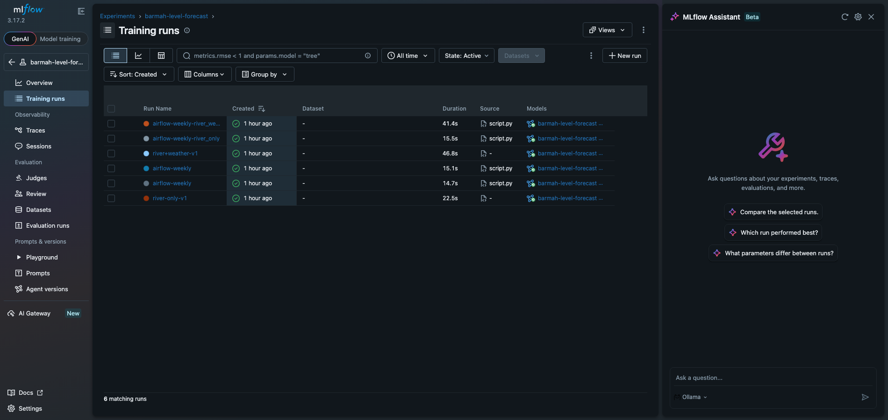
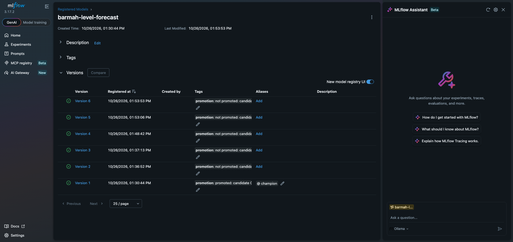

# Murray River Forecast

Forecasts the Murray River's height at Barmah 1–7 days ahead and turns it into a
"good for wakeboarding?" rating. Built with feature / training / inference (FTI)
pipelines that share only a feature store (Feast) and a model registry (MLflow).

**Dashboard:** `site/` (static HTML + `forecast.json`), deployed to GitHub Pages by
`.github/workflows/pages.yml`. Publish the latest forecast with `make publish`.
CI (`.github/workflows/ci.yml`) runs the unit tests and a lockfile check on every pull request;
`make unit` runs the same locally.
Wakeboarding rule: `src/murray/rules/wakeboarding.yaml` (good 2.30–3.00 m, wind ≤ 23 km/h).

**Model page:** `site/model.html` explains the champion: SHAP "why this forecast" per day,
what the model relies on, the Yarrawonga upstream effect, a 2022–2026 backtest, and the full MLflow
registry history with every promotion decision. Exported to `site/models.json` on every inference run.

| MLflow training runs | MLflow model registry (`@champion`) |
|---|---|
|  |  |

**How it works (one page):** [docs/how-it-works.md](docs/how-it-works.md)

## Local stack

```bash
cp .env.example .env      # then replace every change-me (openssl rand -hex 16)
make up                   # = docker compose --env-file .env -f infra/docker-compose.yml up -d --build --wait
uv sync
make test                 # integration tests: Iceberg, MLflow, Valkey
```

| Service   | Address                 | Purpose                                          |
|-----------|-------------------------|--------------------------------------------------|
| Postgres  | `localhost:5432`        | DBs: `iceberg_catalog`, `mlflow`, `airflow` (one user each) |
| SeaweedFS | `http://localhost:8333` | S3 API (path-style), bucket `lakehouse`          |
| MLflow    | `http://localhost:5050` | Tracking + model registry; artifacts in `s3://lakehouse/mlflow` (proxied) |
| Valkey    | `localhost:6379`        | Feast online store (password auth, `noeviction`, RDB snapshots) |
| Airflow   | `http://localhost:8080` | Airflow 3, LocalExecutor. User `admin`, password `AIRFLOW_ADMIN_PASSWORD` in `.env` |

DAGs live in `pipelines/` (mounted live). Tasks run in `/opt/murray/.venv`, built from `uv.lock`,
via `@task.external_python`; Airflow keeps its own Python. After changing `src/` or `uv.lock`,
run `make up` to rebuild the image. Check DAGs with `make dag-errors` and `make dag-test d=smoke_stack`.

Other shortcuts: `make ps`, `make logs s=airflow-scheduler`, `make down`.
Reset everything (re-runs the Postgres init script): `docker compose --env-file .env -f infra/docker-compose.yml down -v`

## Pipelines (so far)

```
raw_gauges_daily (10:00 Melbourne)          → raw.gauge_daily        (Iceberg, append-only)
   └─ asset update ─▶ features_barmah        → features.barmah_daily  (Iceberg, offline store)
                                               └─ feast materialize   → Valkey (online store)
   └─ asset (online) ─▶ inference_barmah      → predictions.barmah_forecast + site/forecast.json
   └─ asset (raw) ─▶ monitoring_barmah        → live error vs backtest → retrain now if degraded
training_barmah (weekly, Sun 03:00)         → Feast historical features + labels → LightGBM
                                               → MLflow `barmah-level-forecast`, @champion only if better
```

**Current champion (v1, river-only, test 2022-01 → 2026-10):** mean error 1.1 cm (1 day ahead) →
9.9 cm (7 days) vs persistence 3.4 → 20.4 cm, i.e. 51–68% better; 13 cm vs 39 cm at 7 days
during release changes.

**Weather experiment:** adding past rainfall (Barmah, Yarrawonga, Ovens@Wangaratta, Albury),
temperature and evaporation scored 5.39 cm mean vs 5.30 cm river-only, so it was not promoted.
At Barmah the river is regulated and upstream rain already shows up in the Yarrawonga gauge.
Weekly training keeps trying both feature sets; the promotion rule decides.

Feast repo: `features/` (`feature_store.yaml`, `definitions.py`); registry in `s3://lakehouse/feast/registry.pb`.

Notebooks: `02_iceberg_sandbox` (Iceberg internals), `03_mlflow_tour` (MLflow storage, aliases, hostnames).

## Data and attribution

River data: the state water agencies behind [MDBA River Murray Data](https://riverdata.mdba.gov.au/),
fetched with MDBA's [gauge-getter](https://github.com/MDBAuth/MDBA_Gauge_Getter):
- Murray River at Barmah (409215): © State of Victoria, Department of Energy, Environment and Climate Action
  ([Water Measurement Information System](https://data.water.vic.gov.au/)), CC BY 4.0.
- Murray River at Yarrawonga Weir (409025): © State Government of NSW and WaterNSW
  ([Real Time Water](https://realtimedata.waternsw.com.au/)), CC BY 4.0.
Weather data: [Weather data by Open-Meteo.com](https://open-meteo.com/) (CC BY 4.0), ERA5-based archive API.
This is a planning aid, not a safety tool.
