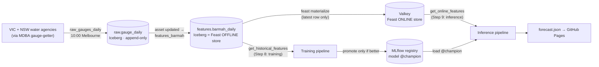

# How the Murray forecast system works

One page: the picture, five rules, and where everything lives. Every rule is tied to
something real in this repo.

## The picture

Underneath it all, two storage services:

- **Postgres** holds *pointers and records*: the Iceberg catalog, MLflow's runs and registry, and Airflow's state.
- **SeaweedFS** (S3) holds *the bytes*: Parquet files, model files, and Feast's registry file.

## Five rules

### 1. Metadata in a database, bytes in S3

| Thing | Database row (Postgres) | Files (S3: `s3://lakehouse/…`) |
|---|---|---|
| Iceberg table | `iceberg_tables.metadata_location` → current metadata.json | metadata.json → manifest list → manifests → Parquet |
| MLflow model | `runs`, `metrics`, `model_versions`, `registered_model_aliases` | `mlflow/<exp>/models/m-…/` (MLmodel, model.pkl) |
| Feast | (registry is a file) | `feast/registry.pb` |

**If you lose the database**, the files still exist but nothing knows what they are. **If you lose the files**, the database points at nothing: notebook 03, section 5, shows a model stuck at `READY` that can't load. Back up both, or neither is useful.

### 2. `localhost` means "this machine"

Inside a container, `localhost` is **that container**. Other services are reached by **compose service name** on the **container's port**.

| Service | From your laptop (`.env`) | From inside Docker (Airflow) |
|---|---|---|
| Postgres | `localhost:5432` | `postgres:5432` |
| S3 | `http://localhost:8333` | `http://seaweedfs:8333` |
| MLflow | `http://localhost:5050` (host port; 5000 = AirPlay) | `http://mlflow:5000` |
| Valkey | `localhost:6379` | `valkey:6379` |

The code is identical in both places. Only the environment variables differ: see `x-airflow-common` in `infra/docker-compose.yml`. Notebook 03, section 6, tests both directions.

### 3. Only use what was known at forecast time

A backtest that sees the future looks brilliant, then fails live. That's **leakage**. Three defences:

- **Feature timestamps.** Day D's average is fetched at **D+1 at 10:00 Melbourne**, so that's its `event_timestamp`. Feast's point-in-time join then gives a forecast made at 09:00 on 3 Mar 2021 the **1 March** row, and at 11:00 the **2 March** row (`tests/test_feast_integration.py`).
- **Revisions.** Agencies correct provisional readings later. `as_of(raw, t)` returns only what had been ingested by time `t`, while `latest(raw)` returns today's corrected view. Caveat: the history was backfilled on 2026-10-26, so true "as known then" values exist only from that date on.
- **The leakage test.** `test_no_future_leakage` changes day D+1 and asserts that day D's features don't move.

### 4. Raw is what the source sent; clean downstream

- `raw.gauge_daily` keeps **everything**, including about 1,900 readings of `0.00 m` with "no data" quality codes (255, 160, 201). Cleaning happens in `transforms/features.py`, where it's visible, tested and changeable. If a cleaning rule turns out wrong, re-run it from raw.
- Raw is **append-only**. The daily job re-fetches 14 days, and a revised value becomes a *new row* with a newer `ingested_at`. Nothing is overwritten.

### 5. Pipelines don't call each other; they share data

Feature, training and inference pipelines (FTI) are connected **only** through the feature store and the model registry.

- `features_barmah` runs when the **raw asset is updated**, not at a clock time, so it never builds features from half-loaded data.
- Training writes a model version. It moves `@champion` **only if the new model beats** the current one *and* the persistence baseline.
- Inference loads `@champion` and reads Valkey. If features are older than the **2-day TTL**, Valkey returns nulls and inference says **"no forecast"** rather than guessing from stale data.

## A day in the life

| Melbourne time | What happens |
|---|---|
| 10:00 | `raw_gauges_daily` fetches the last 14 completed days for both gauges and appends them to raw |
| ~10:01 | Raw asset updated, so `features_barmah` rebuilds the features, runs `feast apply`, and materializes the newest row into Valkey |
| Step 8 | Training (scheduled, e.g. weekly): historical features + labels, then LightGBM, MLflow, and promotion only if better |
| Step 9 | Inference: online features + `@champion` → 7-day forecast → wakeboarding rating → `forecast.json` |

## Numbers to remember

- **Travel time** Yarrawonga → Barmah: ~**4 days** (correlation peak), with a plateau to ~10 days.
- **Persistence baseline** ("tomorrow = today"), average error: **3.3 cm** at 1 day ahead, rising to **18.9 cm** at 7 days. The model must beat this.
- **Weather didn't help** (5.39 vs 5.30 cm): Barmah is regulated, and upstream rain is already in the Yarrawonga gauge.
- **Champion v1 (river-only):** 1.1 cm (h1) → 9.9 cm (h7) average error, 51–68% better than persistence.
- **History:** Barmah from 1974, Yarrawonga from 1970; 17,325 usable feature rows.
